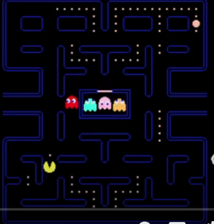

# RL Pacman

Pacman rebuilt as a reinforcement learning environment, and a tabular
Q-learning agent that learns to play it.

The project started as a plain pygame Pacman with BFS ghosts. The game
logic now lives in a headless environment (`reset()` / `step(action)`),
so an agent can play thousands of games per second, and pygame is only
used to watch.



## Quick start

```bash
uv sync --all-extras

uv run rl-pacman play                      # play yourself (arrows / ZQSD / WASD, R restart)
uv run rl-pacman train --layout small      # train, evaluate vs a random agent
uv run rl-pacman watch --layout small      # watch the trained agent
```

`train` writes `runs/latest/qtable.pkl`, `history.csv` and
`training.png` (reward and win-rate curves).

## The environment

| | |
|---|---|
| **State** | Pacman position, ghost positions, remaining dots and pellets, ghosts frightened or not |
| **Actions** | UP, DOWN, LEFT, RIGHT (walking into a wall = staying put) |
| **Rewards** | -1 per step, +10 dot, +50 pellet, +200 eaten ghost, +500 win, -500 death |
| **Ghosts** | Chase Pacman by BFS, take a random move 20% of the time, flee when frightened, move every other step |
| **End** | All dots eaten, caught by a ghost, or 300 steps |

Layouts: `tiny`, `small`, `classic` (in `src/rl_pacman/layouts.py`, easy
to add your own).

## Results

_TODO_

## Why tabular Q-learning stops at small mazes

_TODO_

## Project layout

```
src/rl_pacman/
  grid.py     maze parsing, movement, tunnels, BFS distances
  env.py      game rules and rewards (no pygame)
  agents.py   random baseline + Q-learning agent
  train.py    training / evaluation loops, CSV and plots
  render.py   pygame front-end
  cli.py      play / train / watch
tests/        environment rules
```

Checks: `uv run pytest`, `uv run mypy`, `uv run flake8 src tests`.
